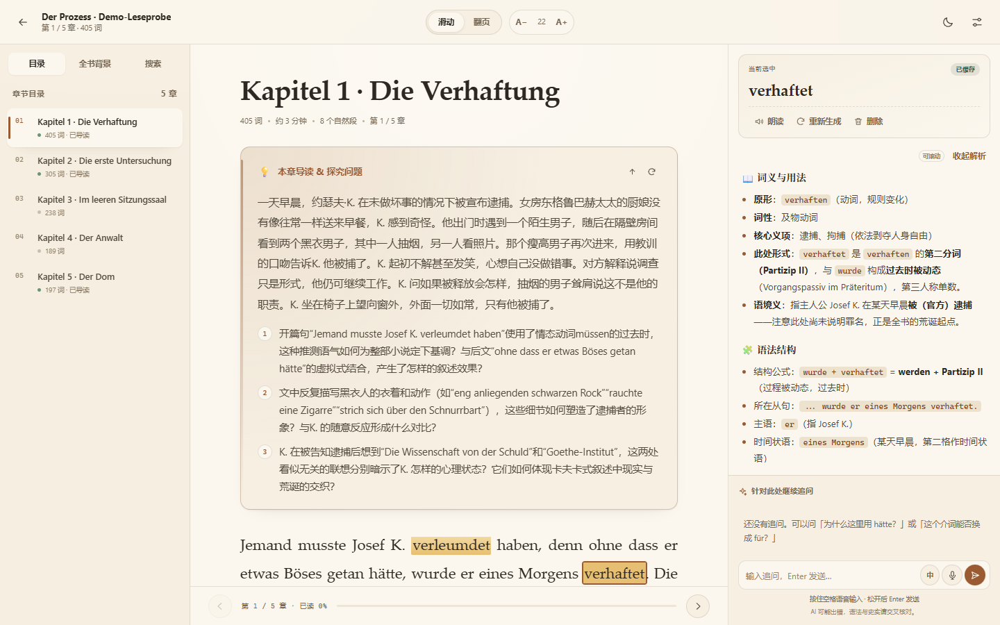
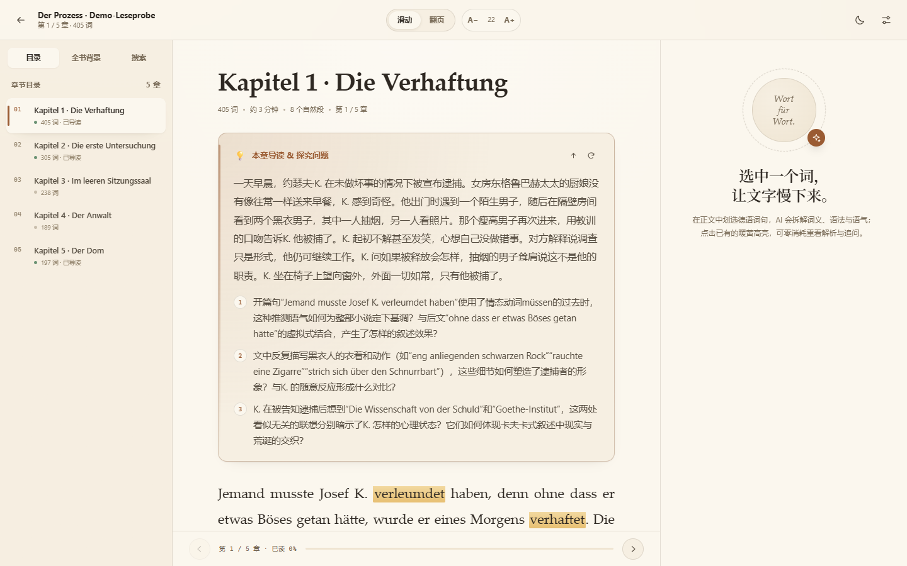
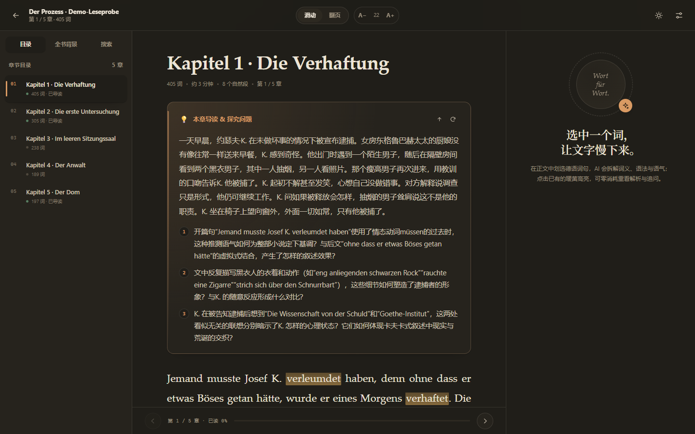
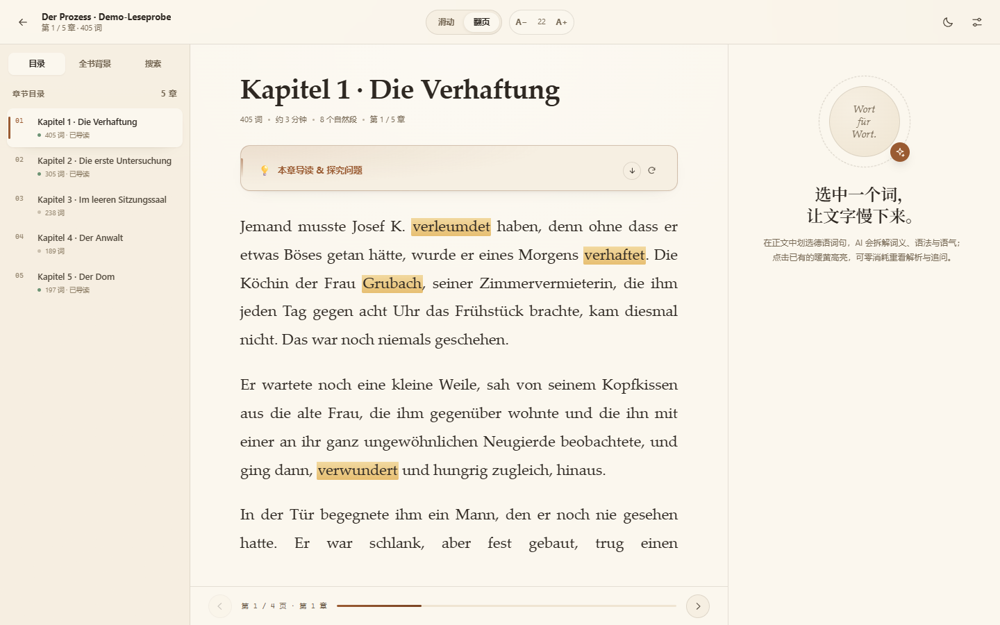
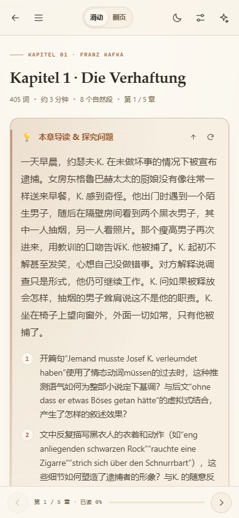

# LLM智读 · LLM-Translator-Reader

面向中文母语学习者的外语 AI 阅读器（目前仅支持德语）。在原文旁完成词句解析、语法学习与多轮追问，让阅读保持连贯。

支持 PDF、EPUB 和 TXT，本地保存书籍与阅读记录，可接入 DeepSeek 或 Gemini。提供浏览器界面、可选桌面窗口，以及同一局域网下的手机和平板访问。



[快速开始](#快速开始) · [使用指南](#使用指南) · [模型与配置](#模型与配置) · [数据与隐私](#数据与隐私) · [开发与测试](#开发与测试)

## 功能

| 功能 | 说明 |
| --- | --- |
| 书籍导入 | 支持 PDF / EPUB / TXT，自动提取正文、清理段落并分章；`.md`、`.text` 按纯文本处理 |
| 中文词句解析 | 选中德语单词、短语或句子，结合上下文讲解词义、语法、搭配与语气 |
| 流式回答 | 划词解析与追问通过 SSE 流式显示，支持重新生成 |
| 标注与缓存 | 自动保存高亮、解析和追问；再次打开已有标注时直接读取本地记录 |
| 章节导读 | 生成章节概要与阅读探究问题，支持折叠、缓存和重新生成 |
| 全书背景 | 生成全书概要、作者生平及历史文化背景；检索不可用时降级为模型知识生成 |
| 阅读体验 | 滑动 / 翻页双模式、浅色 / 深色主题、字号和栏宽调整、阅读位置恢复 |
| 目录与搜索 | 章节导航、全书搜索、搜索结果定位到正文段落 |
| 语音辅助 | 德语朗读、中德语音输入、按住空格说话；可用性取决于浏览器和系统 |
| 多端访问 | 桌面三栏布局、移动端抽屉布局，设置内提供局域网地址与二维码 |
| 自定义 AI | DeepSeek / Gemini / OpenAI 兼容服务；按供应商只显示相关配置，全部 Prompt 可编辑，思考开关与强度可调 |

<details>
<summary>查看更多界面截图</summary>

| 阅读界面 | 夜间阅读 |
| --- | --- |
|  |  |

| 翻页阅读 | 手机阅读 |
| --- | --- |
|  |  |

更多截图见 [docs/](docs/)。截图展示现有界面，实际生成内容随书籍、模型和 Prompt 而变化。

</details>

## 快速开始

### 环境要求

- Python **3.10 或更高版本**。
- 支持现代 JavaScript 的浏览器；语音功能需要浏览器额外支持。
- 首次安装依赖需要联网；使用 AI 功能需要自行配置服务商 API Key，并具备对应模型的访问权限和额度。

下载本仓库 ZIP 并解压，或使用 Git 克隆仓库，然后进入包含 `main.py` 的项目目录。以下命令均在该目录执行。

### Windows

双击 **`start.bat`**。脚本会在需要时创建 `.venv`、安装运行依赖并打开浏览器。

也可以在 PowerShell 中手动运行：

```powershell
python -m venv .venv
.\.venv\Scripts\python.exe -m pip install -r requirements.txt
.\.venv\Scripts\python.exe main.py
```

### macOS / Linux

```bash
bash start.sh
```

或手动运行：

```bash
python3 -m venv .venv
.venv/bin/python -m pip install -r requirements.txt
.venv/bin/python main.py
```

服务启动后，访问 **[http://127.0.0.1:8000](http://127.0.0.1:8000)**。在运行服务的终端按 `Ctrl+C` 停止。

> 未配置 API Key 时仍可导入和阅读书籍、搜索正文、查看已保存的解析；生成新的 AI 内容需要联网及有效 Key。默认监听 `0.0.0.0:8000`，允许局域网访问，访问范围见[数据与隐私](#数据与隐私)。

### 可选：独立桌面窗口

Windows 可双击 **`start_desktop.bat`**，或执行：

```powershell
.\.venv\Scripts\python.exe -m pip install -r requirements-desktop.txt
.\.venv\Scripts\python.exe desktop.py
```

桌面窗口基于 pywebview，仍使用同一个本地服务和数据库。未安装 pywebview 时，`desktop.py` 会回退到浏览器模式；其他系统可用 `.venv/bin/python` 执行相同脚本。

## 使用指南

### 1. 配置 AI

打开右上角设置，在 **AI 模型** 中选择 DeepSeek、Gemini 或 OpenAI 兼容服务；选择某个服务商时只显示它的 Key/模型/Base URL 配置。填好 Key 后保存并测试连接。

当前预设：

| 服务 | 推荐 | 其他 |
| --- | --- | --- |
| DeepSeek | `deepseek-flash`（1M 上下文，支持图像） | `deepseek-v4-pro`（旗舰推理，不支持图像） |
| Gemini | `gemini-3.8-flash`（1M 上下文，低延迟） | `gemini-4-argon`（旗舰）、`gemini-3.5-flash-lite`（轻量） |
| OpenAI 兼容 | 自定义 `Base URL` + 模型名 | 任意实现 `POST /chat/completions` 的服务 |

需要接兼容网关或旧模型时，选「自定义兼容模型…」并填写完整模型名。旧默认值 `deepseek-chat` / `deepseek-reasoner` / `gemini-2.5-flash` 等会在启动时自动迁移到新预设；自定义网关模型名不会被改动。参考：[DeepSeek 模型与价格](https://api-docs.deepseek.com/zh-cn/quick_start/pricing)、[Gemini 模型列表](https://ai.google.dev/gemini-api/docs/models)。

**OpenAI 兼容服务**：填写 Base URL（例如 `https://api.openai.com/v1` 或 `http://localhost:11434/v1`，不要带 `/chat/completions`）和模型名；Key 可留空（本地网关常见）。程序按标准 Chat Completions 发送 `model/messages/stream/max_tokens`，并按「模型思考」开关发送顶层 `reasoning_effort`（关闭为 `none`，低/中/高/最高映射为 low/medium/high/high）；网关不支持时自动省略该参数。不发送 DeepSeek/Gemini 专属的 `thinking` 对象或 `thinkingConfig`。

### 2. 导入书籍

点击 **导入书籍** 或将文件拖入窗口，单文件上限 **200 MB**。可手动指定书名和作者，也可先导入演示文件 [Der Prozess (Demo-Leseprobe).txt](samples/Der%20Prozess%20%28Demo-Leseprobe%29.txt)。演示文本含界面测试补写内容，不应作为原著校订版本使用。

PDF 优先使用一级书签分章；EPUB 结合目录与正文结构；纯文本按标题规则分章，无法识别时约每 3,000 词分节。扫描版 PDF 需要先通过外部 OCR 工具生成文本层；Markdown 文件不会按 Markdown 排版渲染。

导入后会在后台尝试生成全书背景；开启「自动导读」时，还会预生成前两章导读。关闭「自动导读」不会关闭全书背景生成。AI 任务失败不影响已导入正文的阅读，可稍后重试。

### 3. 阅读与划词

- 在 **滑动** 和 **翻页** 模式之间切换；翻页模式支持底部按钮、左右方向键、鼠标滚轮和触屏横向滑动。
- 使用顶部 `A−` / `A+` 调整字号，在设置中调整主题、栏宽和默认阅读模式。
- 在同一段落中选中 **1–500 个字符**，点击解析；默认也会在选中后短暂延迟自动解析，可在设置中关闭。
- 解析完成后保留高亮。点击已有高亮会读取本地解释与追问记录，该操作不重新请求模型。
- 「重新生成」更新解释并保留追问；「删除」移除该标注及其追问。
- 左侧可切换目录、全书背景和搜索；搜索结果可跳转到对应段落。

当前章节保存在数据库中，章节内的具体阅读位置等偏好也使用浏览器本地存储。更换浏览器或设备时，具体位置不保证同步。

### 4. 追问与语音

在解析下方输入问题，`Enter` 发送，`Shift+Enter` 换行。

支持语音识别的浏览器中，可点击麦克风，或在阅读界面按住空格说话、松开结束。输入框已有文字时，空格保留正常输入行为；「中 / 德」可切换识别语言。朗读按钮使用系统或浏览器提供的德语语音。

语音识别需要麦克风权限，并受浏览器安全上下文限制；通过局域网 HTTP 地址访问时可能无法使用。

### 5. 手机和平板

1. 保持电脑上的服务运行，并让设备连接同一局域网。
2. 在设置 → **连接与数据** 中查看局域网地址或扫描二维码。
3. 若无法连接，检查主机防火墙、实际监听地址及路由器的设备隔离设置。

手机访问使用电脑上的同一份书籍、标注与设置。电脑关机或服务停止后，手机页面无法继续从服务读取数据。

## 模型与配置

日常使用可直接在设置中切换供应商、修改 Key / Base URL / 模型、调整思考强度，并编辑全部 Prompt 与阅读偏好。

### API Key

调用时优先使用设置中保存的 Key，其次读取环境变量：`DEEPSEEK_API_KEY`、`GEMINI_API_KEY`（或 `GOOGLE_API_KEY`）、`OPENAI_API_KEY`。OpenAI 兼容服务的 Key 可以留空，适合本地网关。

程序还会在数据库中未保存 DeepSeek Key 时尝试初始化：先查找项目根目录中的 `DeepSeek API Key.txt`、`deepseek_api_key.txt`、`deepseek.key`，再检查 `DEEPSEEK_API_KEY`。符合格式的 Key 会写入数据库。设置 `READER_SKIP_BUNDLED_KEY=1` 可跳过这一步，运行时仍可读取环境变量。

例如，仅在本机监听并使用环境变量提供 Key：

```powershell
$env:READER_HOST = "127.0.0.1"
$env:READER_SKIP_BUNDLED_KEY = "1"
$env:DEEPSEEK_API_KEY = "填入你的 API Key"
.\.venv\Scripts\python.exe main.py
```

macOS / Linux 对应写法：

```bash
READER_HOST=127.0.0.1 READER_SKIP_BUNDLED_KEY=1 DEEPSEEK_API_KEY='填入你的 API Key' .venv/bin/python main.py
```

### 环境变量

| 变量 | 默认值 | 用途 |
| --- | --- | --- |
| `READER_HOST` | `0.0.0.0` | `main.py` 的监听地址；仅本机使用可设为 `127.0.0.1` |
| `READER_PORT` | `8000` | 服务端口；`main.py` 也支持以 `PORT` 作为后备值 |
| `READER_DATA_DIR` | 项目根目录 | 数据库、日志和上传目录的默认存放位置 |
| `READER_DB_PATH` | 数据目录下的 `reader_data.db` | 单独指定数据库路径 |
| `READER_UPLOAD_DIR` | 数据目录下的 `uploads/` | 单独指定原始书籍目录 |
| `READER_OPEN_BROWSER` | 未启用 | `1` 时启动后自动打开浏览器；启动脚本会设置此项 |
| `READER_RELOAD` | 未启用 | `1` 时启用开发热重载 |
| `READER_DEBUG` | 未启用 | `1` 时在服务器错误响应中附带异常类型 |
| `READER_SKIP_BUNDLED_KEY` | 未启用 | `1` 时跳过 DeepSeek Key 自动初始化 |
| `DEEPSEEK_API_KEY` | 空 | DeepSeek Key |
| `GEMINI_API_KEY` / `GOOGLE_API_KEY` | 空 | Gemini Key |
| `OPENAI_API_KEY` | 空 | OpenAI 兼容服务 Key（可留空） |
| `OPENAI_BASE_URL` | `https://api.openai.com/v1` | OpenAI 兼容服务基础地址 |
| `OPENAI_MODEL` | 空 | OpenAI 兼容服务模型名 |
| `DEEPSEEK_BASE_URL` | `https://api.deepseek.com` | DeepSeek 请求基础地址 |
| `GEMINI_BASE_URL` | `https://generativelanguage.googleapis.com/v1beta` | Gemini 请求基础地址 |
| `DEEPSEEK_SEARCH_URL` | `https://api.deepseek.com/v1/tools/search` | 背景生成所尝试的检索接口 |

这些变量需在启动进程前设置。项目不会自动加载 `.env` 文件；更改后需重启服务。

`desktop.py` 当前固定监听 `0.0.0.0`，不读取 `READER_HOST`，可通过 `--port 8001` 指定端口。需要仅本机监听时请使用 `main.py`。

背景检索会尝试使用 DeepSeek 配置，即使当前生成模型为 Gemini。检索失败时自动降级；该接口的可用性取决于服务端或网关，不能将生成的背景视为已经联网核实的资料。

### 自定义 Prompt

设置 → **Prompt** 里可以从下拉框选择并编辑全部模板，不再只限于划词解析：

| 可编辑内容 | 占位符 |
| --- | --- |
| 划词解析 | `{selected_text}`、`{context_sentence}` |
| 章节导读 · 系统提示 | 无 |
| 章节总结与问题 · 用户提示 | `{book_title}`、`{chapter_title}`、`{chapter_text}`、`{language}` |
| 全书背景 · 系统提示 | 无 |
| 全书总结与历史背景 · 用户提示 | `{title}`、`{author}`、`{excerpt}`、`{reference}` |
| 多轮追问 · 系统提示 | 无 |
| 追问上下文（合并进系统背景，只插入一份） | `{selected_text}`、`{context_sentence}`、`{explanation}` |
| 书名与作者识别 · 系统/用户提示 | `{filename}`、`{excerpt}` |

编辑器的「恢复当前默认」只恢复当前选中的模板。模板代码默认值集中在 [prompts.py](prompts.py)（`PROMPT_DEFINITIONS` / `PROMPT_DEFAULTS`）；设置中保存的覆盖值优先，空值回退代码默认。修改代码模板后重启服务；已有解析、背景和导读继续使用缓存，需要手动重新生成。

「追问上下文」不再作为一条重复的用户消息插入：它合并进系统背景，每次请求只出现一份；后续对话按正常的 `user/assistant` 历史追加，不再包含“已了解……”这类假确认消息。

## 数据与隐私

书籍解析与数据存储在运行程序的电脑上完成，AI 功能通过所配置的外部服务处理。

| 数据 | 默认位置 |
| --- | --- |
| 书籍正文、章节、标注、追问、设置 | `reader_data.db` |
| 导入的原始文件 | `uploads/` |
| 运行日志及轮转备份 | `reader.log`、`reader.log.*` |
| 部分阅读位置和界面偏好 | 浏览器本地存储 |

**API Key 在设置中以明文保存在 SQLite 中**，设置接口返回脱敏提示。数据库、上传文件、日志和 Key 文件属于本地数据，发布仓库或提交 Issue 时应排除；尤其不要把包含个人数据的整个运行目录直接上传。

调用外部服务时，发送内容随功能而不同：

- **划词解析**：所选文本、上下文、自定义 Prompt，以及相关书名和章节信息。
- **多轮追问**：所选文本、上下文、已有解释、相关对话历史与本次问题。
- **章节导读**：书名、章节标题及章节正文节选。
- **全书背景与书籍识别**：书名、作者、文件名或正文开头节选；检索请求包含书名、作者等查询词。

自动识别、自动导读及导入后的全书背景任务也可能产生外部请求和 API 费用。浏览器语音识别是否将音频发送给在线服务，取决于浏览器实现。

**当前服务没有账号与访问鉴权。** 默认局域网监听时，可访问该端口的设备能够读取书籍、操作数据和修改设置。请在可信网络中使用；仅在本机使用时，按上文将 `main.py` 的 `READER_HOST` 设为 `127.0.0.1`。

备份前停止服务，保存数据库和 `uploads/`；若仍存在数据库的 `-wal` / `-shm` 伴随文件，也应一并保存。要恢复原始文件下载能力，需保持 `uploads/` 与数据库记录中的文件路径一致。浏览器中的位置记录需另行保留。删除书籍会同时删除其章节、标注、追问及原始文件。

## 开发与测试

后端使用 **FastAPI + SQLite**，前端使用原生 HTML / CSS / JavaScript；PDF 解析使用 PyMuPDF，EPUB 解析使用 EbookLib 和 BeautifulSoup。前端无需 Node.js 构建步骤。

```text
AIReader/
├── main.py                   # 服务入口、API 与后台任务
├── database.py               # SQLite 数据与设置
├── parser.py                 # 文件解析、清洗与分章
├── ai_service.py             # 模型调用、流式响应与检索降级
├── prompts.py                # Prompt 模板
├── desktop.py                # 可选 pywebview 窗口
├── static/                   # 前端页面、样式与脚本
├── tests/                    # 解析、数据库、API 与 AI 服务测试
├── tools/ui_check.py          # Playwright 界面巡检与截图
├── samples/                  # 演示文本
├── docs/                     # 界面截图
├── requirements.txt          # 运行依赖
├── requirements-dev.txt      # 开发依赖（包含运行依赖）
├── requirements-desktop.txt  # 桌面依赖（包含运行依赖）
├── start.bat / start.sh      # 浏览器模式启动脚本
└── start_desktop.bat         # Windows 桌面模式启动脚本
```

### 运行测试

Windows PowerShell：

```powershell
.\.venv\Scripts\python.exe -m pip install -r requirements-dev.txt
.\.venv\Scripts\python.exe -m pytest -q
```

macOS / Linux：

```bash
.venv/bin/python -m pip install -r requirements-dev.txt
.venv/bin/python -m pytest -q
```

测试覆盖文件解析、数据持久化、导入、缓存、追问、设置、流式响应和错误处理。测试使用隔离数据目录与模拟 AI 响应，不能代替真实服务商连接及浏览器交互验证。

可选界面巡检脚本需要本机 Microsoft Edge、运行中的服务以及已导入的演示书籍：

```powershell
.\.venv\Scripts\python.exe tools\ui_check.py http://127.0.0.1:8000
```

脚本会操作书籍、设置和 AI 功能，并覆盖 `docs/ui-*.png` 截图；建议连接隔离的演示数据实例，配置真实 Key 时可能产生费用。

### API 与贡献

服务启动后可查看 [交互式 API 文档](http://127.0.0.1:8000/api/docs)。主要接口包括书籍导入与管理、章节读取、全文搜索、标注解析、流式追问、设置及健康检查；完整请求字段以运行中的 API 文档为准。

反馈问题时，请附上复现步骤、Python 版本、操作系统、浏览器及脱敏后的错误信息。涉及文件解析时，可提供可公开分享的最小样例；提交功能修改时，请说明行为变化和验证方式。

## 常见问题

**端口被占用怎么办？**  
启动前设置 `READER_PORT`，例如 PowerShell 中执行 `$env:READER_PORT = "8001"`，然后重新运行 `main.py`，访问 `http://127.0.0.1:8001`。

**AI 提示无权限、余额不足或限流？**  
检查设置中的 Key、模型名及账号权限与额度。401 通常表示认证或权限问题，402 表示额度问题，429 表示限流；也可使用设置中的连接测试定位问题。

**扫描版 PDF 无法导入，或章节划分不准确？**  
扫描件先做 OCR。章节识别依赖书签、目录与标题结构，复杂版式或文本质量较差的文件可能需要预处理；分章规则位于 [parser.py](parser.py)。

**断网还能使用吗？**  
本地服务运行时，可以阅读已导入正文、搜索和查看已有解析。生成新的 AI 内容需要联网；语音能力取决于浏览器与系统。手机访问也需要保持与电脑的网络连接。

**独立窗口无法启动怎么办？**  
可先使用 `start.bat` 或 `main.py` 打开浏览器界面，再检查 pywebview 及系统 WebView 运行环境。
